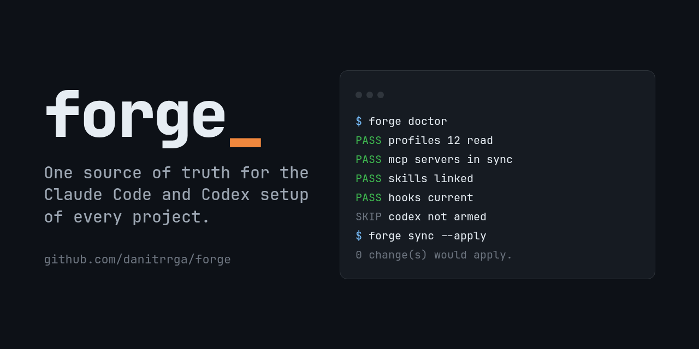
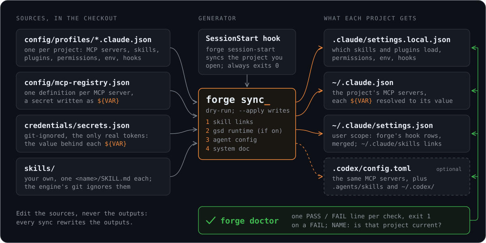

# forge



**One source of truth for the Claude Code and Codex setup of every project on your machine.**

[](https://github.com/danitrrga/forge/actions/workflows/ci.yml)
[](LICENSE)

Every project you work on with an agent grows its own skills, MCP servers, hooks and permissions. Copy them
by hand and they drift: one project has the new server, another still has the old token, a third lost a hook
months ago. forge keeps all of it in one checkout. Each project gets a small profile, one generator writes
every project's files from it, and a SessionStart hook brings the project you open up to date before the
session starts.

## Why forge

- **One command.** `forge sync --apply --all` regenerates every project's configuration from the same source.
- **Per-project profiles.** Each project picks its MCP servers, skills, plugins, permissions, env and hooks in
  one JSON file. Untrimmed, it loads everything you have.
- **Dry-run first, every write declared.** Without `--apply`, `forge sync` only lists what would change. With
  it, every file written is named.
- **`forge doctor` names what is broken and the command that fixes it.** One PASS / FAIL / SKIP / WARN line
  per check, exit 1 on a FAIL.
- **Optional integrations that switch off cleanly.** Codex, GSD, caveman and Hindsight are each one switch.
  Turning one off removes only the entries forge wrote.
- **A personal-data guard.** `forge check-public` and the git hooks refuse a commit that carries a home path,
  an email address, a private IP or a private key, so your own config never leaks into a public repository.

## Quickstart

```sh
git clone https://github.com/danitrrga/forge ~/forge
cd ~/forge
python3 bin/forge init                  # checks your tools, writes your data, syncs, runs doctor
python3 bin/forge add ~/code/myproject  # registers a project and syncs it
python3 bin/forge doctor                # what is broken, and how to fix it
python3 bin/forge sync                  # dry-run: what would change
python3 bin/forge sync --apply          # write it
```

To type `forge` instead, link it onto your PATH: `ln -s ~/forge/bin/forge ~/.local/bin/forge`.

`forge init` checks python, git, `claude`, `pnpm` and `codex`, one line each. It asks at most two questions,
and only for tools it found: manage Codex's config too, and install GSD. `--yes` takes every detected default,
`--with a,b` and `--without a,b` switch integrations, and `--track` gives your data its own local git history.
It then writes your data into the checkout: `config/forge.json` (your switches), a profile for the checkout
itself, an empty MCP registry, `credentials/secrets.json` (mode 600), `docs/AGENT-SYSTEM.md` and an empty
`skills/`. With GSD on, it runs GSD's own installer (`pnpm dlx get-shit-done-cc@latest --claude --global`).
Last, it runs `forge sync --apply --all`, which installs the SessionStart hook, and exits with `forge doctor`'s
status.

`forge add PATH [--name NAME] [--writes-tracked-files]` writes `config/profiles/NAME.claude.json` and runs
`forge sync --apply --project NAME`. It refuses a path that is not a directory, a name already registered and
a name that is not kebab-case. By default forge writes no file git tracks in the project: no pointer in its
`CLAUDE.md`, no `.gitignore` line. The flag allows it.

## How it works



A profile, `config/profiles/<name>.claude.json`, holds a project's path, the MCP servers it gets from
`config/mcp-registry.json`, the skills and plugins it keeps, permissions, env and hooks. The accepted fields
and their types are `PROFILE_FIELDS` in `forge/lib.py`, and `forge sync` names a field of the wrong type
instead of guessing.

The generator writes the per-project keys in `~/.claude.json`, each project's `.claude/settings.local.json`,
the hook rows in `~/.claude/settings.json` (merged, never replaced), the links in `~/.claude/skills` and, with
Codex on, `~/.codex/` and each project's `.codex/config.toml`. These files are generated and overwritten on
every run, so edit the profile, not them. The SessionStart hook runs `forge session-start`, which syncs only
the project you opened, reports only what changed or failed, and always exits 0: a broken sync never blocks a
session. A profile marked `frozen` gets nothing.

`forge/hooks.py` also writes a few hook rows that are safe on any machine and need no switch: the SessionStart
sync, the memory check, a desktop notifier that exits quietly without `omarchy-notification-send`, and a router
that reads `infra/ref/ref-index.tsv` when a project has one. Your own rows go in `user_hooks` in
`config/forge.json`.

## Integrations

Each one is a switch under `integrations` in `config/forge.json`. Set it to `true` and run
`forge sync --apply --all`. Switching one off removes only the entries forge itself wrote, never a hook you
installed another way.

| Integration | What it adds | What it needs | Default |
|---|---|---|---|
| `codex` | `~/.codex/skills`, each project's `.codex/config.toml` and `.agents/skills` links, so Codex sees the same skills; with `codex_harness` true in `config/forge.json` also its hook rows in `~/.codex/hooks.json` and each project's MCP servers in `.codex/config.toml`, with it false (the default, Codex as a reviewer) neither, and forge takes out only what it wrote | `codex` on PATH | off; `init` offers it when `codex` is found |
| `gsd` | the `gsd-*` skills, agents and engine from `get-shit-done-cc`, installed unpatched by `forge init`, and its three hooks | `pnpm`, `node` | off; `init` offers it when `pnpm` is found |
| `caveman` | two hooks around the `caveman` plugin: one injects your own rules from `hooks/caveman_house_rules.md` if you write that file, one makes a `/caveman` level stick in the profile | the plugin, installed in Claude Code; `node` | off |
| `hindsight` | the Hindsight coding-agent memory hooks and its rendered config | Hindsight's coding-agents package, `config/hindsight-coding-agents.json`, `node`; written for one machine's layout, so read `forge/memory.py` first | off |

## Bring your own skills

forge ships **no skills**. Put yours in `skills/<name>/SKILL.md` inside the checkout and run
`forge sync --apply`. forge links each one into `~/.claude/skills`, and each profile's `skills_keep` decides
which of them a project loads (`["*"]` for all). The engine's git ignores `skills/`, so `git pull` never
conflicts with them. `forge init --track` gives your data a second, local history when you want it versioned.

Third-party skills come from their own repositories, for example Anthropic's `skill-creator`,
`kepano/obsidian-skills`, `pbakaus/impeccable` and `Panniantong/Agent-Reach`. The `gsd-*` skills are GSD's own,
installed unpatched from its package when the `gsd` integration is on. forge does not touch them afterwards
(`gsd_patches` in `config/forge.json` is false, which is what `forge init` writes).

## Safety

- **Never writes outside its scope.** Only the installed checkout writes: a linked worktree or a plain copy of
  it writes nothing, and a toy HOME may only write its own toy world. Your own `CLAUDE.md`, `AGENTS.md` and
  `.gitignore` in a project are never written by `forge add`.
- **Dry-run by default.** `forge sync` without `--apply` lists every file it would write and writes none.
- **Secrets stay in one place.** The registry refers to a secret as `${VAR}`, resolved from the git-ignored
  `credentials/secrets.json`. A server whose secret is missing is not written.
- **No personal data in the public history.** `forge check-public --all` scans every engine file for home
  paths, email addresses, private IPv4 ranges, tailnet host names, private-key headers, files over 1 MiB and
  font or image files, except an image pinned by path and sha256 in `PUBLIC_ASSETS` (`forge/publish.py`) after
  someone has looked at it. An optional `config/publish-deny.txt` adds your own patterns. The hooks in `githooks/`
  run it on every commit, commit message and push.

## Commands

```
forge init [--yes] [--with a,b] [--without a,b] [--track]   first run for a new checkout
forge add PATH [--name NAME] [--writes-tracked-files]       register a project and sync it
forge sync [--apply] [--project NAME | --all]               what would change (or change it)
forge doctor [NAME]                                         one line per check; exit 1 on a FAIL
forge log [--since DATE] [NAME]                             the journal of what sync --apply and session start wrote
forge test [--mutants]                                      every tracked test_*.py, at nice 19
forge toolchain [--fix]                                     the global npm and pip packages config/toolchain.json pins
forge commit -m MESSAGE [PATH...]                           commit each changed path to the history that owns it
forge check-public --all                                    personal data in the files the engine publishes
forge metrics NAME [--baseline]                             a project's harness cost, from its Claude Code transcripts
forge uninstall [--integration N | --project N] [--apply]   take out what forge wrote (see Uninstall)
```

Every command takes `--help`. A doctor check with nothing to look at (no skills, an integration that is off,
no toolchain file) prints `SKIP ... NOT RUN, NOT ARMED`, which is neither a pass nor a failure. A check that is
on and broken is a FAIL that names the fix. `forge doctor NAME` shows only the rows that concern one project.

`forge commit` stages each changed path in the history that owns it: a path the engine's `.gitignore` does not
ignore goes to the engine history, every other path to your data history when you have one (`--track`).

## Requirements

- Linux.
- Python 3.10 or newer, git, and Claude Code (`claude`).
- Optional: `codex` for the Codex integration, `pnpm` for GSD, `node` for the GSD, caveman and Hindsight hooks.

`forge init` checks each one and says which are missing.

## Uninstall

`forge uninstall` lists what it would take out; `forge uninstall --apply` takes it out. It removes what forge
wrote and nothing else: each value its ownership record (`~/.local/state/forge/owned.json`) says forge wrote and
that is still unchanged, then what is forge's by construction (the skill links into the checkout, a project's
`.agents/skills` links, the guard hook entries, the copy of `AGENT-SYSTEM.md`, the pointer block in `CLAUDE.md`,
GSD's defaults while they are forge's copy, `~/.cache/forge`), then forge's SessionStart row and last the record
itself. A value you edited stays and is named on a `!` line; a setting forge removed falls back to Claude Code's
default, nothing earlier is restored. Your own hooks, permission rules and `.gitignore` lines stay.

It leaves, and says so: GSD's agents and engine in `~/.claude` (with the command that removes them), any `.bak`
older than the record, and the checkout, whose deletion command it prints and never runs.
`--integration N` takes out one integration's share once it is off in `config/forge.json`; `--project N` one
project's, once its profile is frozen or deleted.

## Not a fit?

forge is a per-machine registry. If you want configuration that travels with each repository, look at
[rulesync](https://github.com/dyoshikawa/rulesync) and [ruler](https://github.com/intellectronica/ruler).

## Contributing

`CLAUDE.md` (also `AGENTS.md`) is the guide for working on the engine. Before you open a pull request:

```sh
python3 bin/forge test                    # every test, in sandboxes that never touch your HOME
python3 bin/forge check-public --all      # no personal data in the engine
git config core.hooksPath githooks        # run the personal-data guard on every commit and push
```

`forge init` sets `core.hooksPath` for you. CI runs `check-public` and a fresh-install test on every push and
pull request.

## License

MIT, see [`LICENSE`](LICENSE). Third-party notices are in [`NOTICE`](NOTICE).
