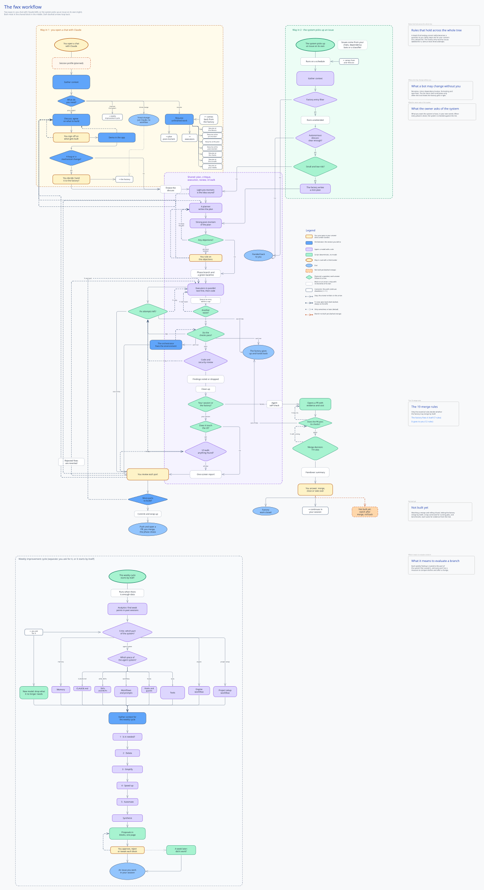
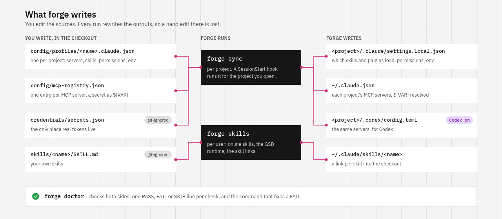
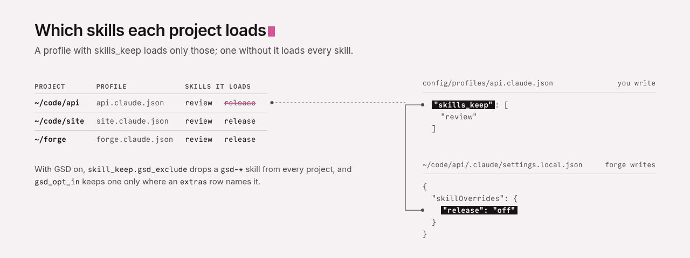
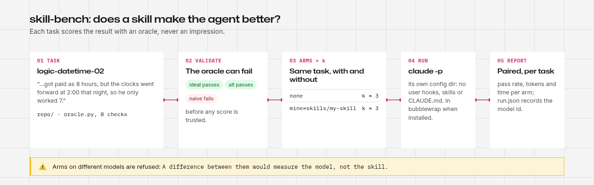

# forge

<picture><source media="(prefers-color-scheme: dark)" srcset="docs/assets/banner-dark.png"></picture>

**An agentic development platform for Claude Code: it sets up every project from one checkout (skills, MCP servers, hooks, project files) and takes each change from discuss to plan, parallel worktree execution, review and UI walk.**

[](https://github.com/danitrrga/forge/actions/workflows/ci.yml)
[](LICENSE)

forge does two jobs, and they are one product.

**It sets up the agents of every project.** Every project you work on with an agent grows its own skills, MCP servers,
hooks and permissions. Copy them by hand and they drift: one project has the new server, another still has the old
token, a third lost a hook months ago. forge keeps all of it in one checkout. Each project gets a small file, one
generator writes every project's files from it, and a SessionStart hook brings the project you open up to date before
the session starts.

**It runs the work with them.** fwx, forge's agentic workflow, takes a change from discuss to plan, runs it in parallel
git worktrees, reviews it and walks the finished UI. It is the part of forge this README leads with:
[The agentic workflow](#the-agentic-workflow).

## Why forge

- **One command.** `forge sync --apply --all` regenerates every project's configuration from the same source.
- **Per-project files.** Each project picks its MCP servers, skills, plugins, permissions, env and hooks in
  one JSON file. Untrimmed, it loads everything you have.
- **Dry-run first, every write declared.** Without `--apply`, `forge sync` only lists what would change. With
  it, every file written is named.
- **`forge doctor` names what is broken and the command that fixes it.** One PASS / FAIL / SKIP / WARN line
  per check, exit 1 on a FAIL.
- **Optional integrations that switch off cleanly.** Codex and Hindsight are each one switch.
  Turning one off removes only the entries forge wrote.
- **An agentic workflow that forge installs and configures.** `plugins/fwx` is a Claude Code plugin that takes work
  from discuss to plan, parallel worktree execution, review and UI walk. One project field, `framework`, turns it on
  (see [The agentic workflow](#the-agentic-workflow)).
- **A personal-data guard.** `forge lint` and the git hooks refuse a commit that carries a home path,
  an email address, a private IP or a private key, so your own config never leaks into a public repository.

## The agentic workflow

fwx lives in `plugins/fwx/`: a Claude Code plugin with a command line, `plugins/fwx/bin/fwx`. It is how forge runs
work, not only how it sets it up. forge installs and configures it per project: `"framework": true` in its project file, then
`forge sync --apply` enables the plugin there and writes the one file it reads, `.claude/fwx.json` (models per role,
round cap, limits, Linear labels, checks). Set the field back to `false` and forge takes it all out again. fwx
replaces the GSD integration, and its changes are reviewed in the same pull requests as the engine's.

<picture></picture>

That is the full workflow, every step and every exit. An interactive version is coming.

Each item below says whether it is **built** (on the default branch), **parked** (built and merged, not in use) or
**planned**. A plan is never described as shipped. [What exists today](#what-exists-today) names the command or file
behind every "built".

### Two ways in, one tree, and a loop

- **A supervised session.** You open a chat. The work goes through discuss, pre-mortem, plan, post-mortem on the plan,
  execution in git worktrees, review, a UI walk when the part touches UI, a report and the close. The orchestrator is
  the only agent that talks to you. Every other agent starts from the same base context and returns a short answer
  with a path. Built and merged from discuss to close, the session skill included. No real session has closed yet: three
  rehearsals on a clone of a real project reached the close, with an operator typing, and the first real session is still
  to come. The UI walk is built and parked.
- **The factory.** It takes a Linear issue labelled `factory` and runs the same steps with nobody watching, each job in
  its own container. Only work on a closed list of mechanical changes is offered to it, every change gets three
  attempts, and in the trial mode it never merges. Afterwards it merges into an integration branch, never into your
  main branch, and you pass that on when you choose. Planned; the pieces around it are built (the stage machine, the
  Linear client, the skill that offers it work, the merge decision).
- **The weekly improvement.** Once a week an agent reads the transcripts of the week and proposes changes to the
  system. It applies Musk's algorithm in series, one agent per step: question the requirement, delete, simplify,
  accelerate, automate, in that order and never faster before the earlier steps are done. Each proposal names the layer
  its fix goes in (the next section) and a reviewer lowers it to the highest layer that works. Planned.

### The opinions behind it

1. **Fix it in code first.** The order of fixes is: code (make the mistake impossible: one owner for each piece of
   state, one way to do each task, a generated list instead of a copied one), then a static check (lint, test, CI, with
   a failure message that says what to use instead), then prose, then a skill. Prose is only for judgment, because
   nothing fails when an agent skips it. A skill is added only when the mistake has happened twice and no layer above
   covers it. This is the inverted pyramid that Lauren Tan, who wrote pstack, describes. A rule without exceptions
   names what enforces it; without an enforcer it is written as a guideline. Built as the rules in
   `plugins/fwx/playbooks/principles.md`; each proposal's `layer` field of the weekly improvement is planned.
2. **Every deciding step is a command, not the model's judgement.** Whether to merge is `fwx decide`. Whether the work
   is good is `fwx verify`, which runs the project's checks on a clean tree at the exact commit. How many fix rounds a
   job may spend is `fwx rounds`. How many agents of a role run at once is the cap in the configuration, a fixed number that
   `fwx wave new` and `fwx walk start` print and the base context states; nothing is measured. Which model a launch uses is `fwx model <role> <size>`, read from the project's file, never from a
   prompt. Which stage may follow which is `fwx stage`, from a table. The orchestrator runs the command and acts on
   what it prints; it does not ask itself the question. Built.
3. **A check is seen to fail before it is trusted.** A test is written first and run against the current code, and the
   failure message is kept. A check that looked at zero things fails. A check that could not run prints
   `NOT RUN, NOT ARMED` and is neither a pass nor a fail; a skipped, neutral or cancelled result from an outside check is
   not green either. The reason: CodeRabbit reports success when it skips a review, and a CI job that times out ends as
   cancelled, not failed. Built: this is the rule of forge's own test suite, and `forge test fwx` exits 77 for a run where a
   test could not run.
4. **Two critiques of every plan.** A pre-mortem comes before the plan: small, fast and cheap, it stops you planning
   work you did not ask for. A post-mortem comes after: much harder, and it asks how each requirement of the plan will be
   verified. An objection is a claim to judge, not something to build: it is checked against the code before the plan
   changes (Every's rule: risk has no natural limit, any design has one more way to fail). A script checks the plan's
   structure first (`fwx plan lint`). Built.
5. **You are asked only what is yours.** A question to you is about taste or direction. It comes with the options,
   what each one implies and a recommendation with its reason, and you decide. What the system can settle alone
   it settles, notes and goes on. Built in the discuss skill.
6. **Whoever checks did not make it.** Reviewers, a verifier that re-checks each finding, and a security reviewer are
   agents other than the executors, and they may find nothing. A dead agent, an empty return or a missing file is a
   failure to report, never "no findings". Built in the `execute` workflow.
7. **Every agent starts from the same base context.** Once the problem is stated, one text, built once per phase and
   capped in size, says what the codebase holds, what you want and how the machinery fits. A `SubagentStart` hook hands
   it to every agent that is launched, by agent type, so a prompt carries only its own part and agents do not each read
   the same documents. Built (`fwx context`, `plugins/fwx/hooks/subagent_context.py`).
8. **Delete before adding.** What always loads costs the most: a study of repository context files (arXiv 2602.11988)
   found that they tend to lower task success and raise cost. The improvement pass deletes before it simplifies and simplifies before it
   automates. The orchestrator also keeps its own context small by delegating: if it compacts before the post-mortem,
   it delegated too little, and that is a signal. Guideline for now.
9. **Clean by construction.** What the system creates (temporary files, worktrees, toy repositories) it removes
   itself, also when it fails. Anything worth keeping is versioned, never left in a temp directory, and nothing assumes
   an operating system. Built as tests (`plugins/fwx/tests/test_temp_cleanup.py`).

### The UI walk

Many cheap agents tour the running app with seeded demo data, try to break every component they can reach, and judge
the screens as a designer would. They do not measure, because taste is not a measurement: what a walker finds is a
finding for you, and a difference from the approved design is reported, not failed. Two details come from experience.
In an earlier trial of this idea the walkers missed a fault that had been planted as a control, so a walk plants one
on a screen no walker is told about, and a walk that does not find it proves nothing and says so. And the walk touches
only a local app with demo data and a demo account: its browser tool refuses any other address. The walk finds; the
session fixes, one commit per finding. The walk is built and merged (the workflow `plugins/fwx/workflows/ui-walk.js`, the `fwx walk` command and the walker agents) and parked until forge is
practically finished: in the live walks so far the planted fault was never found, so a walk says its result does not count.
Its UI-system rebuild is the work that follows.

### Borrowed on purpose

Most of the design is copied from people who do this well, kept short, and every playbook, skill and workflow names its
source in a `referent:` line.

- **pstack** (Lauren Tan): the layers of a fix, the shape of the playbooks, a plan as a list of boxes, the rule that
  an agent's own report does not count when a verifier disagrees.
- **marshal**: the factory, with a label that opts work in and three fix rounds per job.
- **Every's compound engineering**: the brainstorm that the discuss follows, risk as a claim to judge.
- **Matt Pocock**: grilling for the discuss and ticket-writing for the factory's issues; his sandcastle was studied for
  running agents in containers.
- **GSD**: what fwx replaces, and where its phases and waves come from.
- **Elon Musk**: the five-step algorithm of the weekly improvement.

### What exists today

- **Built, on the default branch:** the discuss, pre-mortem, plan and post-mortem skills and agents; the `execute`
  workflow (waves of executors in worktrees, up to three fix rounds per job, the gate, reviewers, the verifier, the
  security reviewer); the project's state under `.fwx/`; the stage table; the base context and its hook; the Linear
  client and the `factory-issue` skill that offers work to the factory; the merge decision; the statusline
  command; the session skill that carries a work item from discuss to close (`plugins/fwx/skills/session/`); the UI walk
  (`plugins/fwx/workflows/ui-walk.js`, `fwx walk`), parked; and forge's
  framework step that installs all of it. No real session has closed yet.
- **Retired:** MemPalace, a memory store that was tried and removed. The code projects keep claude-mem-lite, and Hindsight
  stays an optional integration.
- **Planned, not built:** the factory's unattended runner, the weekly improvement, and an interactive version of the
  tree.

```sh
python3 plugins/fwx/bin/fwx --help              # every command, one line each
python3 bin/forge test fwx                      # fwx's own suite, a group of forge test (forge test with no group leaves it out; CI runs it as the fwx job)
```

`plugins/fwx/README.md` has the command list, the configuration file and the install steps.

## Quickstart

```sh
git clone https://github.com/danitrrga/forge ~/forge
cd ~/forge
python3 bin/forge init                  # checks your tools, writes your data, syncs, runs doctor
python3 bin/forge new ~/code/myproject  # registers an existing project and syncs it
python3 bin/forge new myproject --stack generic --apply   # or makes one in projects_dir, then syncs it
python3 bin/forge doctor                # what is broken, and how to fix it
python3 bin/forge sync                  # dry-run: what would change
python3 bin/forge sync --apply          # write it
```

To type `forge` instead, link it onto your PATH: `ln -s ~/forge/bin/forge ~/.local/bin/forge`.

`forge init` checks python, git, `claude`, `pnpm` and `codex`, one line each. It asks at most one question,
and only for a tool it found: manage Codex's config too. `--yes` takes every detected default,
`--with a,b` and `--without a,b` switch integrations, and `--track` gives your data its own local git history.
It then writes your data into the checkout: `config/forge.json` (your switches), a project file for the checkout
itself, an empty MCP registry, `credentials/secrets.json` (mode 600), `docs/AGENT-SYSTEM.md` and an empty
`skills/`. Then it runs `forge skills --apply`, then `forge sync --apply --all`, which installs the SessionStart hook, and
exits with `forge doctor`'s status.

`forge new PATH [--name NAME] [--writes-tracked-files]` registers the existing directory PATH: it writes
`config/projects/NAME.claude.json` and runs `forge sync --apply NAME`. It refuses a path that is not a directory, a name already
registered and a name that is not kebab-case. By default forge writes no file git tracks in the project: no pointer in its
`CLAUDE.md`, no `.gitignore` line. The flag allows it.

The pointer block that `sync_system_doc.py` keeps in each managed project's `CLAUDE.md` (Codex reads it through the `AGENTS.md`
link) can carry rules of your own: put markdown in `config/system-pointer-extra.md` and the next sync adds it inside the block,
after the pointer text. A missing or blank file adds nothing. A source that is not a regular file (a broken link, a folder), is
over 8 KiB (it loads in every session of every project), cannot be read as UTF-8 or holds one of the block's own markers stops
the sync with a `!` line and exit 1 before anything is written.

`forge new NAME [--path DIR] [--stack generic] [--framework] [--yes] [--apply]` makes the project in `projects_dir` of
`config/forge.json` (or in `DIR`, which must exist): its folder, `git init`, a `.gitignore` written first, a one-line `README.md`, the
project file, its `skill_keep.extras` row and `forge sync --apply NAME`. Without `--apply` it prints the plan and writes nothing.
A missing answer (today only `--stack` and the folder) is named in one error before the first write, with or without `--yes`, so no
half-made project is left; a failure, TERM or INT after that removes what the run made. A name is kebab-case (so never `@x` or `-x`).
Name or path: an argument written as a path (a `/`, or a leading `.` or `~`) is always a directory to register; a bare word that is no
directory in the current folder is always a name to make; a bare word that is a directory there is registered, and the first line says so
(with `--stack`, `--path`, `--framework` or `--apply` it is refused instead, naming both ways out). The folder is never inside the checkout,
and in a toy HOME never outside its world; two runs at once take turns. `--framework` writes `framework: true`, `factory: "off"`, the stack's `checks` and `plugins_keep` (the framework plugin is turned on
through it, and a project that names `plugins_keep` has no other plugin on). So that turning the framework on turns nothing off, `plugins_keep`
holds every plugin the plain project would have: the ones on in `~/.claude/settings.json`, the stack's, and `skill_keep.common_plugins`
(`--plugin` still chooses, as it does without `--framework`). It is refused in one line, before the first write, when the framework plugin
cannot be served (`framework.plugin_source`). `protected_paths`, `checks_quick` and, for a project with `ui: true`, `app_run` need a look at
the project, so they are left out and `forge doctor NAME` says `NOT RUN, NOT ARMED` for them (the `framework fields` row, a PASS once
they are set). Only with `--framework`, after the sync `forge new` runs `forge doctor NAME` and prints its report, then prints (and writes nowhere)
the handover `examples/new-handoff.md` for an agent in the project's folder to propose those values (its `checks` are the ones the project file
holds), and ends with how to open a session: `cd FOLDER && claude`. A fresh project always fails doctor's `instruction files` row (no `CLAUDE.md`
yet; forge writes none) and that is tolerated; any other FAIL row ends the run with exit 1, after saying the project was made.

## Profiles

A profile is a named variant of one project (`@docs`, `@code`): its own skills, servers, permissions and env, started by flags, so
no file of the project is written and two windows can run two profiles at once. The flags of each command are in [Commands](#commands)
and in its `--help`.

```sh
forge new myapp --stack generic --profiles code,docs --apply   # once: a project with two profiles (asks what no flag answers, in a terminal)
cd ~/code/myapp
forge list @                         # the profiles this project offers; `forge list @docs` is one, with its difference from the default
claude @docs                         # a session with profile docs; plain `claude` starts the default as before
forge switch @code                   # inside that session: claude restarts as code and resumes the conversation
forge run @code "list your skills"   # from a session or script: one headless run in another profile, only its answer on stdout
forge config @docs --off skill:grilling --on server:neon       # change one profile's skills, sets, servers or options (dry-run without a terminal; --apply writes)
forge new @review --apply            # add a profile to the project of this folder (asks what no flag answers, in a terminal)
forge doctor myapp                   # where to look when something fails: each check, scoped to the project
```

`claude @docs` needs the shell function `forge shim` prints; without it, `forge start @docs` does the same. The completion
(`claude @<TAB>`, commands, projects, `--on`/`--off` values) is a script per shell. Neither is installed for you; each is written once
into the shell's own files (fish shown; `forge shim --help` and `forge completion --help` give the zsh and bash lines):

```sh
forge shim --shell fish > ~/.config/fish/conf.d/forge-claude.fish
forge completion fish > ~/.config/fish/conf.d/forge-completion.fish
```

To undo either, delete the file: `claude` is the binary again.

## How it works

<picture><source media="(prefers-color-scheme: dark)" srcset="docs/assets/fig-sync-dark.png"></picture>

A project file, `config/projects/<name>.claude.json`, holds the project's path, the MCP servers it gets from
`config/mcp-registry.json`, the skills and plugins it keeps, permissions, env and hooks. The accepted fields
and their types are `PROJECT_FIELDS` in `forge/lib.py`, and `forge sync` names a field of the wrong type
instead of guessing.

`forge sync` writes the per-project keys in `~/.claude.json`, each project's `.claude/settings.local.json`,
the hook rows in `~/.claude/settings.json` (merged, never replaced) and, with Codex on, `~/.codex/` and each
project's `.codex/config.toml`. `forge skills` writes what belongs to the user rather than to a project: the
online skills and the links in `~/.claude/skills`. These files are generated and overwritten on
every run, so edit the project file, not them. The SessionStart hook runs `forge session-start`, which syncs only
the project you opened, reports only what changed or failed, and always exits 0: a broken sync never blocks a
session. A project marked `frozen` gets nothing.

`forge/hooks.py` also writes a few hook rows that are safe on any machine and need no switch: the SessionStart
sync, the memory check, a desktop notifier that exits quietly without `omarchy-notification-send`, and a router
that reads `infra/ref/ref-index.tsv` when a project has one. Your own rows go in `user_hooks` in
`config/forge.json`.

## Integrations

Each one is a switch under `integrations` in `config/forge.json`. Set it to `true` and run
`forge sync --apply --all`. Switching one off removes only the entries forge itself wrote, never a hook you
installed another way.

| Integration | What it adds | What it needs | Default |
|---|---|---|---|
| `codex` | `~/.codex/skills`, each project's `.codex/config.toml` and `.agents/skills` links, so Codex sees the same skills; with `codex_harness` true in `config/forge.json` also its hook rows in `~/.codex/hooks.json` and each project's MCP servers in `.codex/config.toml`, with it false (the default, Codex as a reviewer) neither, and forge takes out only what it wrote | `codex` on PATH | off; `init` offers it when `codex` is found |
| `hindsight` | the Hindsight coding-agent memory hooks and its rendered config | Hindsight's coding-agents package, `config/hindsight-coding-agents.json`, `node`; written for one machine's layout, so read `forge/memory.py` first | off |
| `consent` | one user-scope `PreToolUse` hook row (`hooks/guard_tool_use.py --consent`, `onFailure: block`) that makes a push to a production branch, a command, or an MCP tool that acts on production wait for a yes in a window of its own; production is each project's `production` field and the rules are in `config/gateway.json` | Omarchy and `gum` for the built-in adapter, `python3` | off. Roll back: set `integrations.consent` to `false` and run `forge sync --apply`, which removes the row even when `config/gateway.json` is broken |
| `agent_browser` | asks for the `agent-browser` browser tool: a `config/toolchain.json` entry whose `when` is `{"integration": "agent_browser"}` is installed by `forge toolchain --fix` only while this is `true`, and `forge doctor` FAILs, naming that command, when the binary is not on PATH | `agent-browser`, installed by mise from that toolchain entry | off. Roll back: set `integrations.agent_browser` to `false`; the entry is then a SKIP and nothing is uninstalled |

## Bring your own skills

forge ships **no skills**. Put yours in `skills/<name>/SKILL.md` inside the checkout and run
`forge skills --apply`. forge links each one into `~/.claude/skills`, and each project's `skills_keep` decides
which of them a project loads (`["*"]` for all). The engine's git ignores `skills/`, so `git pull` never
conflicts with them. `forge init --track` gives your data a second, local history when you want it versioned.

Third-party skills come from their own repositories, for example Anthropic's `skill-creator`,
`kepano/obsidian-skills`, `pbakaus/impeccable` and `Panniantong/Agent-Reach`.

<picture><source media="(prefers-color-scheme: dark)" srcset="docs/assets/fig-trim-dark.png"></picture>

## Measure a skill: skill-bench

Does a skill make the agent better, and at what cost? `scripts/bench/skill_bench.py` answers with numbers. Each
task in `benchmarks/skill-bench/tasks/` is a small repository, a prompt in the owner's voice and an oracle that
scores the result, plus a correct answer, a second correct answer built differently and the plausible wrong one.
`validate` proves every oracle can fail and can pass before any score is trusted.

<picture><source media="(prefers-color-scheme: dark)" srcset="docs/assets/fig-bench-dark.png"></picture>

`run` logs in with a long-lived token, not with your own login. Run `claude setup-token` once and store the token under the key
FORGE_MEASURE_OAUTH_TOKEN in the secret store (config/secrets.json); without it `run` refuses to start. `validate` and `report` need no token.

```sh
python3 scripts/bench/skill_bench.py validate          # every task: the ideal and alt answers pass, the naive one fails
python3 scripts/bench/skill_bench.py run --arm none --arm mine=skills/my-skill --k 3
python3 scripts/bench/skill_bench.py report --base none # paired comparison, tokens and time per arm
```

Each run is `claude -p` in its own config directory (no user hooks, skills or `CLAUDE.md`), inside bubblewrap
when installed. Results go to `$XDG_DATA_HOME/forge/skill-bench/runs/`. Every run records its model id and Claude
Code version, and `report` refuses to compare arms that ran on different models. `calibrate` and `--tasks hard`
keep only the tasks a model can still fail. A project can keep its own tasks, with hidden tests, in
`.bench/tasks/`. The format and the statistics are in `benchmarks/skill-bench/README.md`, the sources and their
licences in `SOURCES.md`.

## Safety

- **Never writes outside its scope.** Only the installed checkout writes: a linked worktree or a plain copy of
  it writes nothing, and a toy HOME may only write its own toy world. Your own `CLAUDE.md`, `AGENTS.md` and
  `.gitignore` in a project are never written by `forge new` (a project it makes gets its own, new, `.gitignore`).
- **Dry-run by default.** `forge sync` without `--apply` lists every file it would write and writes none.
- **Secrets stay in one place.** The registry refers to a secret as `${VAR}`, resolved from the git-ignored
  `credentials/secrets.json`. A server whose secret is missing is not written.
- **No personal data in the public history.** `forge lint --all` scans every engine file for home
  paths, email addresses, private IPv4 ranges, tailnet host names, private-key headers, files over 1 MiB and
  font or image files, except an image pinned by path and sha256 in `PUBLIC_ASSETS` (`forge/publish.py`) after
  someone has looked at it. An optional `config/publish-deny.txt` adds your own patterns. The hooks in `githooks/`
  run it on every commit, commit message and push.

## Commands

```
forge init [--yes] [--with a,b] [--without a,b] [--track]   first run for a new checkout
forge new PATH|NAME|@NAME [--stack S] [--profiles A,B] [--sets S] [--skills a,b] [--server N] [--account-server SERVICE[=PIN]] [--memory lite|hindsight|none] [--worktree-guard] [--no-baseline] [--no-git] [--apply]  register a directory, make a project (asks what no flag answers, in a terminal; `--sets @code:A` replaces the unscoped `--sets` for profile code), or make profile @NAME here
forge sync [NAME | --all] [--apply]                         what would change (or change it), per project
forge skills [--apply]                                      online skills from the manifest, the skill links in ~/.claude/skills
forge doctor [NAME]                                         one line per check; exit 1 on a FAIL
forge log [--since DATE] [NAME]                             the journal of what sync --apply and session start wrote
forge test [fwx] [--mutants]                                every tracked test_*.py but plugins/fwx's, up to 4 at once at nice 19 (--jobs N; 1 is serial); `fwx`: that suite alone (--jobs N, --expect-not-run P,..)
forge toolchain [--fix]                                     the third-party tools config/toolchain.json pins, installed by mise
forge start NAME [ARGS...]                                  claude started with the environment a launcher of config/forge.json declares
forge start @NAME [--dry-run] [ARGS...]                     claude started with a profile of this project, by flags alone: no file of the project is written
forge list [NAME] [--json] [--names]                        every project with a short card, or one project's full card (where each skill comes from); `--json` says the same as the text
forge list @ | @NAME [--json] [--names] [--session ID]      the profiles a project declares, or one of them with its difference from the default
forge config [NAME] [@PROFILE] --on|--off TYPE:NAME ... [--apply|--yes] [--json]   change a project's skills (`skill:`), skill sets (`set:`), servers (`server:`) and options (`option:ui`, `command_guard`, `enableAllProjectMcpServers`), each in the layer that owns it (a common skill in `common_opt_out`, an extras skill in its row, a profile's skill in its row), as many as wanted in one all-or-nothing write; a skill that arrives through a set is refused with the two commands that work; a dry-run without a terminal unless `--apply` or `--yes`, `[y/N]` in one
forge switch @NAME                                          inside a session started by `forge start @A` (new, or `--resume UUID`; not `-c`, a title or a bare `--resume`): claude restarts with profile NAME and resumes the conversation
forge run @NAME "PROMPT" [--model M] [--cwd DIR] [--permission-mode MODE] [--timeout SECONDS] [--json]       one headless session with profile NAME (an agent launching another): only its final answer on stdout (with --json, claude's whole JSON result), `sonnet` unless --model; MODE is default, plan, acceptEdits or dontAsk; the child is sent TERM after --timeout seconds (default 1800) and KILL KILL_AFTER (15 s) later if it ignores it, exit 124, and a forge run inside a forge run inside a forge run is refused
forge shim [--shell fish|zsh|bash] | --check @NAME         print a shell function `claude`: `claude @NAME` runs `forge start @NAME` when this project offers that profile (or it is the default label); any other `claude`, `claude @notes.md` (a file mention) included, is the real one, and a plain `claude` is never wrapped nor probed (the probe costs about 33 ms), so in a project with profiles it starts the default as before
forge completion fish|zsh|bash                          print the completion script of a shell (nothing is installed): commands and flags from the parser, and the projects, this directory's `@` profiles and the `--on`/`--off` values (`forge config --names`) asked of `forge` at each tab; `claude @` completes too, every other `claude` word is left to what completed it before
forge lock [--apply]                                        record the versions mise does not install (plugins, outside skills, MCP packages)
forge versions [--md]                                       those and the toolchain pins, for release notes
forge update [NAME... | --all] [--apply]                    what each `track: latest` entry of config/toolchain.json would move to (tools by `mise latest`, online-skill archives by `git ls-remote`, pip libraries by PyPI, only with a wheel for the pinned python); `--apply` writes the file, then runs `forge toolchain --fix`, `forge skills --apply` (when an archive changed) and `forge lock --apply`, stopping at the first failure; a frozen entry is skipped with its why
forge commit -m MESSAGE (PATH... | --all)                   commit each changed path to the history that owns it
forge lint [--root DIR] --all                               personal data in the files the engine publishes (--root: another repository's)
forge metrics NAME [--baseline]                             a project's harness cost, from its Claude Code transcripts
forge uninstall [NAME | --integration N] [--apply]          take out what forge wrote (see Uninstall)
```

Every command takes `--help`. A doctor check with nothing to look at (no skills, an integration that is off,
no toolchain file) prints `SKIP ... NOT RUN, NOT ARMED`, which is neither a pass nor a failure. A check that is
on and broken is a FAIL that names the fix. `forge doctor NAME` shows only the rows that concern one project.
The `project roots` row fails a project that has skills of its own and sits inside another project's git
repository: Claude Code applies the outer project's settings there too, and the outer "off" wins over the inner
"on". The fix is one repository per project.

`forge start NAME [ARGS...]` starts `claude` with the environment of the launcher NAME, declared in
`config/forge.json` as `"launchers": {"orq": {"env": {"CACHE_TAX_AUTOWARM": "on"}}}`: one kind of session carries a
variable and the others do not. It replaces itself with `claude`, passes every argument after NAME untouched
(`forge start orq --model opus -c`), and lists the launchers when given no name. An unknown name or a malformed
table exits 2; no `claude` on PATH exits 127.

`forge commit` stages each changed path in the history that owns it: a path the engine's `.gitignore` does not
ignore goes to the engine history, every other path to your data history when you have one (`--track`).

## Requirements

- Linux.
- Python 3.10 or newer, git, and Claude Code (`claude`).
- Optional: `codex` for the Codex integration, `node` for the Hindsight hooks.

`forge init` checks each one and says which are missing.

## Uninstall

`forge uninstall` lists what it would take out; `forge uninstall --apply` takes it out. It removes what forge
wrote and nothing else: each value its ownership record (`~/.local/state/forge/owned.json`) says forge wrote and
that is still unchanged, then what is forge's by construction (the skill links into the checkout, a project's
`.agents/skills` links, the guard hook entries, the copy of `AGENT-SYSTEM.md`, the pointer block in `CLAUDE.md`,
`~/.cache/forge`), then forge's SessionStart row and last the record
itself. A value you edited stays and is named on a `!` line; a setting forge removed falls back to Claude Code's
default, nothing earlier is restored. Your own hooks, permission rules and `.gitignore` lines stay.

It leaves, and says so: any `.bak`
older than the record, and the checkout, whose deletion command it prints and never runs.
`--integration N` takes out one integration's share once it is off in `config/forge.json`; a project NAME (`forge uninstall NAME`) one
project's, once it is frozen or its file deleted.

## Not a fit?

forge is a per-machine registry. If you want configuration that travels with each repository, look at
[rulesync](https://github.com/dyoshikawa/rulesync) and [ruler](https://github.com/intellectronica/ruler).

## Contributing

`CLAUDE.md` (also `AGENTS.md`) is the guide for working on the engine. Before you open a pull request:

```sh
python3 bin/forge test                    # every test but plugins/fwx's, in sandboxes that never touch your HOME
python3 bin/forge test fwx                # only when you touched plugins/fwx: its suite is a group of its own
python3 bin/forge lint --all      # no personal data in the engine
git config core.hooksPath githooks        # run the personal-data guard on every commit and push
```

`forge init` sets `core.hooksPath` for you. CI runs `lint`, a fresh-install test and the tests that read the documentation
on every push and pull request, and the engine suite and fwx's suite on every push to the default branch. A pull request runs
only the suite its changed paths can affect (`.github/scripts/select_suites.py` holds the rules; a path it does not know runs both).

## License

Apache License 2.0, see [`LICENSE`](LICENSE), for the whole repository including `plugins/fwx`. Third-party notices are in [`NOTICE`](NOTICE).
