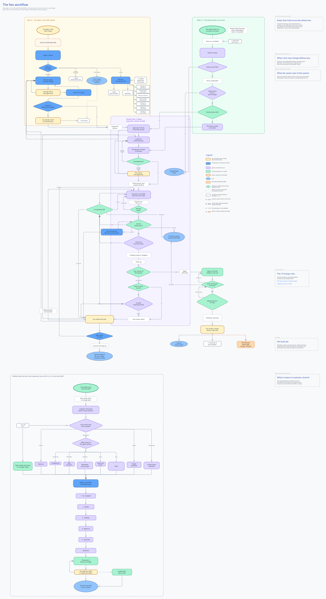
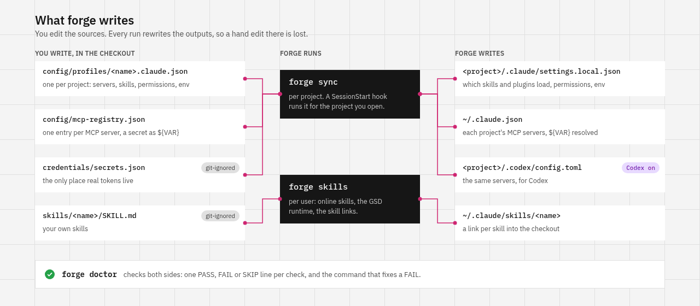
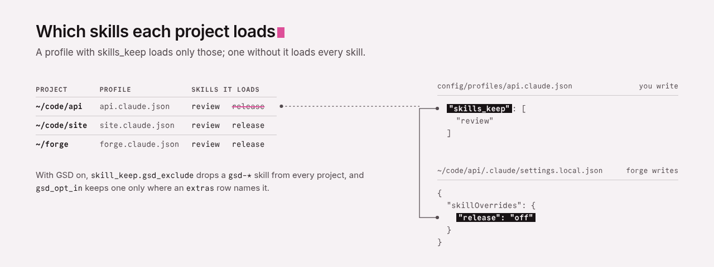
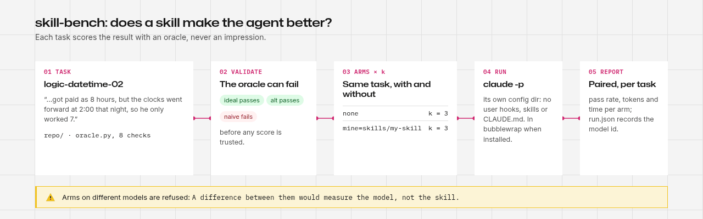

# forge

<picture><source media="(prefers-color-scheme: dark)" srcset="docs/assets/banner-dark.png"></picture>

**An agentic development platform for Claude Code: it sets up every project from one checkout (skills, MCP servers, hooks, profiles) and takes each change from discuss to plan, parallel worktree execution, review and UI walk.**

[](https://github.com/danitrrga/forge/actions/workflows/ci.yml)
[](LICENSE)

forge does two jobs, and they are one product.

**It sets up the agents of every project.** Every project you work on with an agent grows its own skills, MCP servers,
hooks and permissions. Copy them by hand and they drift: one project has the new server, another still has the old
token, a third lost a hook months ago. forge keeps all of it in one checkout. Each project gets a small profile, one
generator writes every project's files from it, and a SessionStart hook brings the project you open up to date before
the session starts.

**It runs the work with them.** fwx, forge's agentic workflow, takes a change from discuss to plan, runs it in parallel
git worktrees, reviews it and walks the finished UI. It is the part of forge this README leads with:
[The agentic workflow](#the-agentic-workflow).

## Why forge

- **One command.** `forge sync --apply --all` regenerates every project's configuration from the same source.
- **Per-project profiles.** Each project picks its MCP servers, skills, plugins, permissions, env and hooks in
  one JSON file. Untrimmed, it loads everything you have.
- **Dry-run first, every write declared.** Without `--apply`, `forge sync` only lists what would change. With
  it, every file written is named.
- **`forge doctor` names what is broken and the command that fixes it.** One PASS / FAIL / SKIP / WARN line
  per check, exit 1 on a FAIL.
- **Optional integrations that switch off cleanly.** Codex, GSD and Hindsight are each one switch.
  Turning one off removes only the entries forge wrote.
- **An agentic workflow that forge installs and configures.** `plugins/fwx` is a Claude Code plugin that takes work
  from discuss to plan, parallel worktree execution, review and UI walk. One profile field, `framework`, turns it on
  (see [The agentic workflow](#the-agentic-workflow)).
- **A personal-data guard.** `forge check-public` and the git hooks refuse a commit that carries a home path,
  an email address, a private IP or a private key, so your own config never leaks into a public repository.

## The agentic workflow

fwx lives in `plugins/fwx/`: a Claude Code plugin with a command line, `plugins/fwx/bin/fwx`. It is how forge runs
work, not only how it sets it up. forge installs and configures it per project: `"framework": true` in a profile, then
`forge sync --apply` enables the plugin there and writes the one file it reads, `.claude/fwx.json` (models per role,
round cap, limits, Linear labels, checks). Set the field back to `false` and forge takes it all out again. fwx
replaces the GSD integration, and its changes are reviewed in the same pull requests as the engine's.

<picture></picture>

That is the full workflow, every step and every exit. An interactive version is coming.

Each item below says whether it is **built** (on the default branch), **on a branch** (written, not merged) or
**planned**. A plan is never described as shipped. [What exists today](#what-exists-today) names the command or file
behind every "built".

### Two ways in, one tree, and a loop

- **A supervised session.** You open a chat. The work goes through discuss, pre-mortem, plan, post-mortem on the plan,
  execution in git worktrees, review, a UI walk when the part touches UI, a report and the close. The orchestrator is
  the only agent that talks to you. Every other agent starts from the same base context and returns a short answer
  with a path. Built up to review; the UI walk and the glue that carries a session from discuss to close are on
  branches.
- **The factory.** It takes a Linear issue labelled `factory` and runs the same steps with nobody watching, each job in
  its own container. Only work on a closed list of mechanical changes is offered to it, every change gets three
  attempts, and in the trial mode it never merges. Afterwards it merges into an integration branch, never into your
  main branch, and you pass that on when you choose. Planned; the pieces around it are built (the stage machine, the
  Linear client, the skill that offers it work, the merge decision).
- **The weekly improvement.** Once a week an agent reads the transcripts of the week and proposes changes to the
  system. It applies Musk's algorithm in series, one agent per step: question the requirement, delete, simplify,
  accelerate, automate, in that order and never faster before the earlier steps are done. Each proposal names the layer
  its fix goes in (the next section) and a reviewer lowers it to the highest layer that works. Planned.

### The opinions behind it

1. **Fix it in code first.** The order of fixes is: code (make the mistake impossible: one owner for each piece of
   state, one way to do each task, a generated list instead of a copied one), then a static check (lint, test, CI, with
   a failure message that says what to use instead), then prose, then a skill. Prose is only for judgment, because
   nothing fails when an agent skips it. A skill is added only when the mistake has happened twice and no layer above
   covers it. This is the inverted pyramid that Lauren Tan, who wrote pstack, describes. A rule without exceptions
   names what enforces it; without an enforcer it is written as a guideline. Built as the rules in
   `plugins/fwx/playbooks/principles.md`; each proposal's `layer` field of the weekly improvement is planned.
2. **Every deciding step is a command, not the model's judgement.** Whether to merge is `fwx decide`. Whether the work
   is good is `fwx verify`, which runs the project's checks on a clean tree at the exact commit. How many fix rounds a
   job may spend is `fwx rounds`. How many agents of a role may start is `fwx capacity`, from the configured cap and the
   free memory. Which model a launch uses is `fwx model <role> <size>`, read from the project's file, never from a
   prompt. Which stage may follow which is `fwx stage`, from a table. The orchestrator runs the command and acts on
   what it prints; it does not ask itself the question. Built.
3. **A check is seen to fail before it is trusted.** A test is written first and run against the current code, and the
   failure message is kept. A check that looked at zero things fails. A check that could not run prints
   `NOT RUN, NOT ARMED` and is neither a pass nor a fail; a skipped, neutral or cancelled result from an outside check is
   not green either. The reason: CodeRabbit reports success when it skips a review, and a CI job that times out ends as
   cancelled, not failed. Built: this is the rule of forge's own test suite, and `fwx test` exits 77 for a run where a
   test could not run.
4. **Two critiques of every plan.** A pre-mortem comes before the plan: small, fast and cheap, it stops you planning
   work you did not ask for. A post-mortem comes after: much harder, and it asks how each requirement of the plan will be
   verified. An objection is a claim to judge, not something to build: it is checked against the code before the plan
   changes (Every's rule: risk has no natural limit, any design has one more way to fail). A script checks the plan's
   structure first (`fwx plan check`). Built.
5. **You are asked only what is yours.** A question to you is about taste or direction. It comes with the options and
   what each one implies, and with no recommendation, so you decide without pressure. What the system can settle alone
   it settles, notes and goes on. Built in the discuss skill.
6. **Whoever checks did not make it.** Reviewers, a verifier that re-checks each finding, and a security reviewer are
   agents other than the executors, and they may find nothing. A dead agent, an empty return or a missing file is a
   failure to report, never "no findings". Built in the `execute` workflow.
7. **Every agent starts from the same base context.** Once the problem is stated, one text, built once per phase and
   capped in size, says what the codebase holds, what you want and how the machinery fits. A `SubagentStart` hook hands
   it to every agent that is launched, by agent type, so a prompt carries only its own part and agents do not each read
   the same documents. Built (`fwx context-base`, `plugins/fwx/hooks/subagent_context.py`).
8. **Delete before adding.** What always loads costs the most: a study of repository context files (arXiv 2602.11988)
   found that they tend to lower task success and raise cost. The improvement pass deletes before it simplifies and simplifies before it
   automates. The orchestrator also keeps its own context small by delegating: if it compacts before the post-mortem,
   it delegated too little, and that is a signal. Guideline for now.
9. **Clean by construction.** What the system creates (temporary files, worktrees, toy repositories) it removes
   itself, also when it fails. Anything worth keeping is versioned, never left in a temp directory, and nothing assumes
   an operating system. Built as tests (`plugins/fwx/tests/test_temp_cleanup.py`).

### The UI walk

Many cheap agents tour the running app with seeded demo data, try to break every component they can reach, and judge
the screens as a designer would. They do not measure, because taste is not a measurement: what a walker finds is a
finding for you, and a difference from the approved design is reported, not failed. Two details come from experience.
In an earlier trial of this idea the walkers missed a fault that had been planted as a control, so a walk plants one
on a screen no walker is told about, and a walk that does not find it proves nothing and says so. And the walk touches
only a local app with demo data and a demo account: its browser tool refuses any other address. The walk finds; the
session fixes, one commit per finding. The playbook is on the default branch (`plugins/fwx/playbooks/ui-walk.md`). The
workflow, the `fwx walk` command and the walker agents are on the branch `feat/3.5-ui-walk`, not merged.

### Borrowed on purpose

Most of the design is copied from people who do this well, kept short, and every playbook, skill and workflow names its
source in a `referent:` line.

- **pstack** (Lauren Tan): the layers of a fix, the shape of the playbooks, a plan as a list of boxes, the rule that
  an agent's own report does not count when a verifier disagrees.
- **marshal**: the factory, with a label that opts work in and three fix rounds per job.
- **Every's compound engineering**: the brainstorm that the discuss follows, risk as a claim to judge.
- **Matt Pocock**: grilling for the discuss and ticket-writing for the factory's issues; his sandcastle was studied for
  running agents in containers.
- **GSD**: what fwx replaces, and where its phases and waves come from.
- **Elon Musk**: the five-step algorithm of the weekly improvement.

### What exists today

- **Built, on the default branch:** the discuss, pre-mortem, plan and post-mortem skills and agents; the `execute`
  workflow (waves of executors in worktrees, up to three fix rounds per job, the gate, reviewers, the verifier, the
  security reviewer); the project's state under `.fwx/`; the stage table; the base context and its hook; the Linear
  client and the `factory-issue` skill that offers work to the factory; the merge decision; the statusline and budget
  commands; the playbooks of the session and of the UI walk; and forge's framework step that installs all of it.
- **On a branch, not merged:** the session skill that carries a work item from discuss to close
  (`feat/3.2-session`), and the UI walk (`feat/3.5-ui-walk`).
- **Planned, not built:** the factory's unattended runner, the weekly improvement, memory, and an interactive version of
  the tree.

```sh
python3 plugins/fwx/bin/fwx --help              # every command, one line each
python3 plugins/fwx/bin/fwx playbooks tree      # the workflow tree: each node and its exits
python3 plugins/fwx/bin/fwx test                # fwx's own suite (forge test leaves it to this; CI runs it as the fwx job)
```

`plugins/fwx/README.md` has the command list, the configuration file and the install steps.

## Quickstart

```sh
git clone https://github.com/danitrrga/forge ~/forge
cd ~/forge
python3 bin/forge init                  # checks your tools, writes your data, syncs, runs doctor
python3 bin/forge add ~/code/myproject  # registers a project and syncs it
python3 bin/forge doctor                # what is broken, and how to fix it
python3 bin/forge sync                  # dry-run: what would change
python3 bin/forge sync --apply          # write it
```

To type `forge` instead, link it onto your PATH: `ln -s ~/forge/bin/forge ~/.local/bin/forge`.

`forge init` checks python, git, `claude`, `pnpm` and `codex`, one line each. It asks at most two questions,
and only for tools it found: manage Codex's config too, and install GSD. `--yes` takes every detected default,
`--with a,b` and `--without a,b` switch integrations, and `--track` gives your data its own local git history.
It then writes your data into the checkout: `config/forge.json` (your switches), a profile for the checkout
itself, an empty MCP registry, `credentials/secrets.json` (mode 600), `docs/AGENT-SYSTEM.md` and an empty
`skills/`. With GSD on, it runs GSD's own installer (`pnpm dlx @opengsd/gsd-core@latest --claude --global`).
Then it runs `forge skills --apply`, then `forge sync --apply --all`, which installs the SessionStart hook, and
exits with `forge doctor`'s status.

`forge add PATH [--name NAME] [--writes-tracked-files]` writes `config/profiles/NAME.claude.json` and runs
`forge sync --apply --project NAME`. It refuses a path that is not a directory, a name already registered and
a name that is not kebab-case. By default forge writes no file git tracks in the project: no pointer in its
`CLAUDE.md`, no `.gitignore` line. The flag allows it.

## How it works

<picture><source media="(prefers-color-scheme: dark)" srcset="docs/assets/fig-sync-dark.png"></picture>

A profile, `config/profiles/<name>.claude.json`, holds a project's path, the MCP servers it gets from
`config/mcp-registry.json`, the skills and plugins it keeps, permissions, env and hooks. The accepted fields
and their types are `PROFILE_FIELDS` in `forge/lib.py`, and `forge sync` names a field of the wrong type
instead of guessing.

`forge sync` writes the per-project keys in `~/.claude.json`, each project's `.claude/settings.local.json`,
the hook rows in `~/.claude/settings.json` (merged, never replaced) and, with Codex on, `~/.codex/` and each
project's `.codex/config.toml`. `forge skills` writes what belongs to the user rather than to a project: the
online skills, the GSD runtime and the links in `~/.claude/skills`. These files are generated and overwritten on
every run, so edit the profile, not them. The SessionStart hook runs `forge session-start`, which syncs only
the project you opened, reports only what changed or failed, and always exits 0: a broken sync never blocks a
session. A profile marked `frozen` gets nothing.

`forge/hooks.py` also writes a few hook rows that are safe on any machine and need no switch: the SessionStart
sync, the memory check, a desktop notifier that exits quietly without `omarchy-notification-send`, and a router
that reads `infra/ref/ref-index.tsv` when a project has one. Your own rows go in `user_hooks` in
`config/forge.json`.

## Integrations

Each one is a switch under `integrations` in `config/forge.json`. Set it to `true` and run
`forge sync --apply --all`. Switching one off removes only the entries forge itself wrote, never a hook you
installed another way.

| Integration | What it adds | What it needs | Default |
|---|---|---|---|
| `codex` | `~/.codex/skills`, each project's `.codex/config.toml` and `.agents/skills` links, so Codex sees the same skills; with `codex_harness` true in `config/forge.json` also its hook rows in `~/.codex/hooks.json` and each project's MCP servers in `.codex/config.toml`, with it false (the default, Codex as a reviewer) neither, and forge takes out only what it wrote | `codex` on PATH | off; `init` offers it when `codex` is found |
| `gsd` | the `gsd-*` skills, agents and engine from `@opengsd/gsd-core`, installed unpatched by `forge init`, and its three hooks | `pnpm`, `node` | off; `init` offers it when `pnpm` is found |
| `hindsight` | the Hindsight coding-agent memory hooks and its rendered config | Hindsight's coding-agents package, `config/hindsight-coding-agents.json`, `node`; written for one machine's layout, so read `forge/memory.py` first | off |
| `consent` | one user-scope `PreToolUse` hook row (`hooks/guard_tool_use.py --consent`, `onFailure: block`) that makes a push to a production branch, a command, or an MCP tool that acts on production wait for a yes in a window of its own; production is each profile's `production` field and the rules are in `config/gateway.json` | Omarchy and `gum` for the built-in adapter, `python3` | off. Roll back: set `integrations.consent` to `false` and run `forge sync --apply`, which removes the row even when `config/gateway.json` is broken |
| `agent_browser` | asks for the `agent-browser` browser tool: a `config/toolchain.json` entry whose `when` is `{"integration": "agent_browser"}` is installed by `forge toolchain --fix` only while this is `true`, and `forge doctor` FAILs, naming that command, when the binary is not on PATH | `agent-browser`, installed by mise from that toolchain entry | off. Roll back: set `integrations.agent_browser` to `false`; the entry is then a SKIP and nothing is uninstalled |
| `mempalace` | nothing yet: the switch for the MemPalace memory part | the MemPalace part's own check, which arrives with that part | off; `forge doctor` shows a SKIP, `NOT RUN, NOT ARMED`, whether it is on or off, until then |

With `gsd_patches` true, `"gsd_isolation_guard": false` in `config/forge.json` switches off the one GSD hook row
`gsd-agent-isolation-guard.js`: the next `forge sync --apply` takes forge's entry out of `~/.claude/settings.json`
(GSD's own entry for that file stays), and `forge doctor`'s `gsd isolation guard` row is a SKIP. A missing key or
`true` writes it; any other value is read as `true` and the doctor row FAILs on it.

## Bring your own skills

forge ships **no skills**. Put yours in `skills/<name>/SKILL.md` inside the checkout and run
`forge skills --apply`. forge links each one into `~/.claude/skills`, and each profile's `skills_keep` decides
which of them a project loads (`["*"]` for all). The engine's git ignores `skills/`, so `git pull` never
conflicts with them. `forge init --track` gives your data a second, local history when you want it versioned.

Third-party skills come from their own repositories, for example Anthropic's `skill-creator`,
`kepano/obsidian-skills`, `pbakaus/impeccable` and `Panniantong/Agent-Reach`. The `gsd-*` skills are GSD's own,
installed unpatched from its package when the `gsd` integration is on. forge does not touch them afterwards
(`gsd_patches` in `config/forge.json` is false, which is what `forge init` writes). To trim them, name skills in
`skill_keep.gsd_exclude` (no profile keeps them, and forge does not link them) or `skill_keep.gsd_opt_in` (kept
only by a profile whose `skill_keep.extras` row names them); `forge doctor`'s `skill keep` row fails on a name
no skill has, a name in both lists, or an excluded name in an `extras` row.

<picture><source media="(prefers-color-scheme: dark)" srcset="docs/assets/fig-trim-dark.png"></picture>

## Measure a skill: skill-bench

Does a skill make the agent better, and at what cost? `scripts/bench/skill_bench.py` answers with numbers. Each
task in `benchmarks/skill-bench/tasks/` is a small repository, a prompt in the owner's voice and an oracle that
scores the result, plus a correct answer, a second correct answer built differently and the plausible wrong one.
`validate` proves every oracle can fail and can pass before any score is trusted.

<picture><source media="(prefers-color-scheme: dark)" srcset="docs/assets/fig-bench-dark.png"></picture>

`run` logs in with a long-lived token, not with your own login. Run `claude setup-token` once and store the token under the key
FORGE_MEASURE_OAUTH_TOKEN in the secret store (config/secrets.json); without it `run` refuses to start. `validate` and `report` need no token.

```sh
python3 scripts/bench/skill_bench.py validate          # every task: the ideal and alt answers pass, the naive one fails
python3 scripts/bench/skill_bench.py run --arm none --arm mine=skills/my-skill --k 3
python3 scripts/bench/skill_bench.py report --base none # paired comparison, tokens and time per arm
```

Each run is `claude -p` in its own config directory (no user hooks, skills or `CLAUDE.md`), inside bubblewrap
when installed. Results go to `$XDG_DATA_HOME/forge/skill-bench/runs/`. Every run records its model id and Claude
Code version, and `report` refuses to compare arms that ran on different models. `calibrate` and `--tasks hard`
keep only the tasks a model can still fail. A project can keep its own tasks, with hidden tests, in
`.bench/tasks/`. The format and the statistics are in `benchmarks/skill-bench/README.md`, the sources and their
licences in `SOURCES.md`.

## Safety

- **Never writes outside its scope.** Only the installed checkout writes: a linked worktree or a plain copy of
  it writes nothing, and a toy HOME may only write its own toy world. Your own `CLAUDE.md`, `AGENTS.md` and
  `.gitignore` in a project are never written by `forge add`.
- **Dry-run by default.** `forge sync` without `--apply` lists every file it would write and writes none.
- **Secrets stay in one place.** The registry refers to a secret as `${VAR}`, resolved from the git-ignored
  `credentials/secrets.json`. A server whose secret is missing is not written.
- **No personal data in the public history.** `forge check-public --all` scans every engine file for home
  paths, email addresses, private IPv4 ranges, tailnet host names, private-key headers, files over 1 MiB and
  font or image files, except an image pinned by path and sha256 in `PUBLIC_ASSETS` (`forge/publish.py`) after
  someone has looked at it. An optional `config/publish-deny.txt` adds your own patterns. The hooks in `githooks/`
  run it on every commit, commit message and push.

## Commands

```
forge init [--yes] [--with a,b] [--without a,b] [--track]   first run for a new checkout
forge add PATH [--name NAME] [--writes-tracked-files]       register a project and sync it
forge sync [--apply] [--project NAME | --all]               what would change (or change it), per project
forge skills [--apply]                                      online skills from the manifest, the skill links in ~/.claude/skills, the GSD runtime
forge doctor [NAME]                                         one line per check; exit 1 on a FAIL
forge log [--since DATE] [NAME]                             the journal of what sync --apply and session start wrote
forge test [--mutants]                                      every tracked test_*.py, at nice 19 (plugins/fwx has its own runner, `fwx test`)
forge toolchain [--fix]                                     the third-party tools config/toolchain.json pins, installed by mise
forge launch NAME [ARGS...]                                 claude started with the environment a launcher of config/forge.json declares
forge lock [--apply]                                        record the versions mise does not install (plugins, outside skills, GSD, MCP packages)
forge versions [--md]                                       those and the toolchain pins, for release notes
forge commit -m MESSAGE (PATH... | --all)                   commit each changed path to the history that owns it
forge check-public [--root DIR] --all                       personal data in the files the engine publishes (--root: another repository's)
forge metrics NAME [--baseline]                             a project's harness cost, from its Claude Code transcripts
forge uninstall [--integration N | --project N] [--apply]   take out what forge wrote (see Uninstall)
```

Every command takes `--help`. A doctor check with nothing to look at (no skills, an integration that is off,
no toolchain file) prints `SKIP ... NOT RUN, NOT ARMED`, which is neither a pass nor a failure. A check that is
on and broken is a FAIL that names the fix. `forge doctor NAME` shows only the rows that concern one project.
The `project roots` row fails a project that has skills of its own and sits inside another project's git
repository: Claude Code applies the outer project's settings there too, and the outer "off" wins over the inner
"on". The fix is one repository per project.

`forge launch NAME [ARGS...]` starts `claude` with the environment of the launcher NAME, declared in
`config/forge.json` as `"launchers": {"orq": {"env": {"CACHE_TAX_AUTOWARM": "on"}}}`: one kind of session carries a
variable and the others do not. It replaces itself with `claude`, passes every argument after NAME untouched
(`forge launch orq --model opus -c`), and lists the launchers when given no name. An unknown name or a malformed
table exits 2; no `claude` on PATH exits 127.

The `research expiry` row reads each project's `.planning/research/**/*.md` (only the first 20 lines of a file, none
over 1 MB) and warns about the ones whose header says they are stale. A research file may carry `expires: YYYY-MM-DD`
(bare, or inside `---` front matter; any case) and `volatility: high|medium|low`: the date is the last day the
research stands, and the row names the file the day after. A file without the header is counted and never flagged; a
date that is not YYYY-MM-DD is an `unreadable expiry`, also a warning. The fix is to re-check the research and move
the date, or delete the file.

`forge commit` stages each changed path in the history that owns it: a path the engine's `.gitignore` does not
ignore goes to the engine history, every other path to your data history when you have one (`--track`).

## Requirements

- Linux.
- Python 3.10 or newer, git, and Claude Code (`claude`).
- Optional: `codex` for the Codex integration, `pnpm` for GSD, `node` for the GSD and Hindsight hooks.

`forge init` checks each one and says which are missing.

## Uninstall

`forge uninstall` lists what it would take out; `forge uninstall --apply` takes it out. It removes what forge
wrote and nothing else: each value its ownership record (`~/.local/state/forge/owned.json`) says forge wrote and
that is still unchanged, then what is forge's by construction (the skill links into the checkout, a project's
`.agents/skills` links, the guard hook entries, the copy of `AGENT-SYSTEM.md`, the pointer block in `CLAUDE.md`,
GSD's defaults while they are forge's copy, `~/.cache/forge`), then forge's SessionStart row and last the record
itself. A value you edited stays and is named on a `!` line; a setting forge removed falls back to Claude Code's
default, nothing earlier is restored. Your own hooks, permission rules and `.gitignore` lines stay.

It leaves, and says so: GSD's agents and engine in `~/.claude` (with the command that removes them), any `.bak`
older than the record, and the checkout, whose deletion command it prints and never runs.
`--integration N` takes out one integration's share once it is off in `config/forge.json`; `--project N` one
project's, once its profile is frozen or deleted.

## Not a fit?

forge is a per-machine registry. If you want configuration that travels with each repository, look at
[rulesync](https://github.com/dyoshikawa/rulesync) and [ruler](https://github.com/intellectronica/ruler).

## Contributing

`CLAUDE.md` (also `AGENTS.md`) is the guide for working on the engine. Before you open a pull request:

```sh
python3 bin/forge test                    # every test, in sandboxes that never touch your HOME
python3 plugins/fwx/bin/fwx test           # only when you touched plugins/fwx: its suite has its own runner
python3 bin/forge check-public --all      # no personal data in the engine
git config core.hooksPath githooks        # run the personal-data guard on every commit and push
```

`forge init` sets `core.hooksPath` for you. CI runs `check-public`, a fresh-install test and fwx's suite on every push and
pull request.

## License

Apache License 2.0, see [`LICENSE`](LICENSE), for the whole repository including `plugins/fwx`. Third-party notices are in [`NOTICE`](NOTICE).
